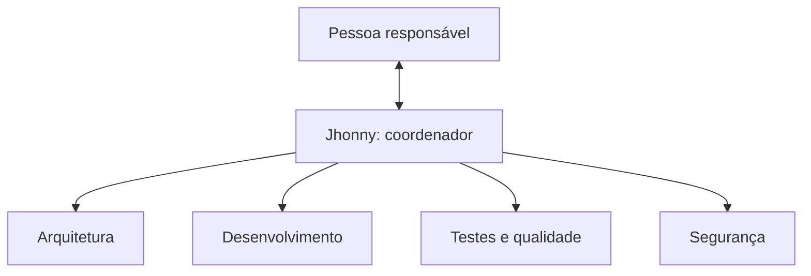
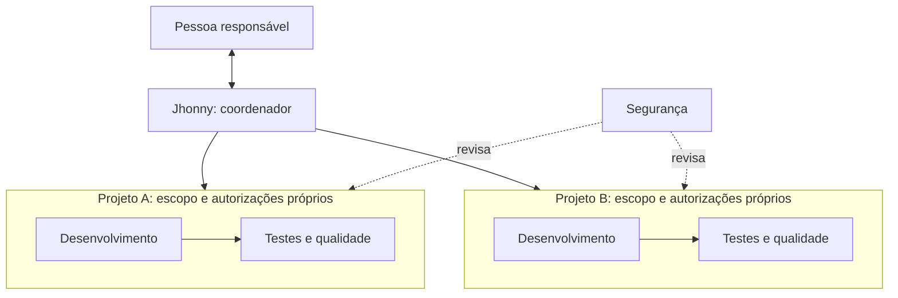

# ORQUESTRA — coordenação multiagente e multiprojeto para desenvolvimento com IA

> **Este repositório é uma apresentação pública de um projeto privado.** Ele contém apenas texto e diagramas escritos para este fim. Não há código, configurações, prompts, logs, arquivos de governança nem tarefas reais do sistema original.

Autor: [Danilo Vieira da Silva](https://github.com/DaniloVS22) · Outro projeto: [PINEA](https://github.com/DaniloVS22/pinea-case-study)

**Ideia central:** a ORQUESTRA busca transformar o desenvolvimento assistido por IA em um processo **coordenado, reutilizável e seguro para múltiplos projetos**.

## O problema

Ao desenvolver software com agentes de IA, quem coordena acaba virando mensageiro: copia respostas de um agente para outro, repete o contexto e não sabe ao certo quem verificou o quê. Com mais de um projeto, piora: o contexto de um se mistura ao do outro, e fica difícil garantir que um agente só mexa no que foi autorizado.

## A ideia

A ORQUESTRA foi concebida como uma plataforma de orquestração **multiagente** e **multiprojeto**. Em vez de conversar com vários agentes, a pessoa conversa com **um coordenador, o Jhonny**. Ele organiza o trabalho de agentes especializados em diferentes projetos de software, respeitando escopos, autorizações e controles de segurança. Quem executa não aprova o próprio trabalho.

É um projeto experimental de método, e não uma plataforma comercial em produção.

## Arquitetura multiagente

| Papel | Responsabilidade |
|---|---|
| **Jhonny (coordenador)** | Único ponto de contato com a pessoa responsável. Investiga, propõe o plano, distribui tarefas e mantém o estado. |
| Arquitetura | Desenha a solução e as decisões técnicas. |
| Desenvolvimento | Implementa o que foi aprovado, dentro do escopo. |
| Testes e qualidade | Valida o resultado de forma independente de quem o escreveu. |
| Segurança | Revisa riscos e pode bloquear uma entrega. |

## Suporte a múltiplos projetos e repositórios

A mesma ORQUESTRA atende projetos diferentes, cada um com seu próprio repositório. Os princípios do desenho:

- **Cadastro de projetos:** cada projeto atendido é registrado explicitamente. O que não está cadastrado não é tocado.
- **Escopo por projeto:** as autorizações valem para um projeto por vez, e um agente só escreve onde foi autorizado.
- **Isolamento:** o trabalho de cada tarefa acontece em área própria e separada, para que tarefas e projetos não se contaminem.
- **Contexto separado:** o histórico, as decisões e as regras de um projeto não se misturam com os de outro.
- **Governança comum, regras locais:** o método de trabalho é o mesmo; cada projeto mantém suas próprias regras.

## Coordenação e distribuição de tarefas

1. A pessoa faz um pedido ao coordenador e indica o projeto.
2. O coordenador investiga e propõe um plano com escopo, riscos e critérios de aceite.
3. A pessoa aprova (ou pede ajustes). Sem aprovação, nada é executado.
4. As tarefas são distribuídas aos agentes especializados, cada uma em área isolada.
5. Testes e revisão independentes validam o resultado.
6. O que foi feito e decidido é registrado, e o coordenador reporta à pessoa.

## Exemplo fictício: dois projetos, uma ORQUESTRA

O exemplo é inventado e serve só para ilustrar o método.

| | Projeto A: aplicativo de pedidos | Projeto B: site de documentação |
|---|---|---|
| Pedido | adicionar filtro por data na lista | corrigir links quebrados em uma seção |
| Escopo aprovado | apenas a tela de listagem | apenas o conteúdo da seção |
| Execução | agente de desenvolvimento, em área isolada | agente de desenvolvimento, em outra área isolada |
| Validação | testes do filtro | verificação dos links |
| Revisão | segurança e coordenação | segurança e coordenação |
| Registro | plano, decisões e verificações do Projeto A | plano, decisões e verificações do Projeto B |

As duas demandas passam pelo mesmo coordenador e seguem o mesmo método, mas o escopo, o histórico e as autorizações de um não valem para o outro. Um agente autorizado no Projeto A não altera o Projeto B.

## Governança, rastreabilidade e isolamento

- **Aprovação de plano:** para pedidos amplos, o plano é aprovado antes da execução.
- **Fiscalização independente:** ninguém aprova o próprio trabalho.
- **Limites de escopo:** depois da aprovação, os agentes trabalham com autonomia, mas só dentro do que foi combinado.
- **Alto risco e custos:** decisões desse tipo voltam para a pessoa responsável.
- **Rastreabilidade:** cada tarefa deixa registro do plano, das decisões e das verificações. O resumo é o padrão e o detalhe fica sob demanda.
- **Isolamento entre projetos:** escopo, contexto e autorizações são separados por projeto.

## Estado das capacidades

Classificação conforme as evidências disponíveis no histórico do projeto privado. Ela descreve o que foi observado, não uma promessa.

| Capacidade | Situação |
|---|---|
| Coordenador único e papéis especializados | **Implementada** (em uso experimental) |
| Aprovação de plano e fiscalização independente | **Implementada** (em uso experimental) |
| Registro e rastreabilidade de tarefas e decisões | **Implementada** (em uso experimental) |
| Cadastro de projeto externo e controle de escrita por identidade | **Implementada** |
| Áreas de trabalho isoladas e execução paralela de tarefas | **Implementada** |
| Atendimento a projetos diferentes | **Parcial.** Um projeto externo foi usado como piloto. O atendimento simultâneo a vários ainda não foi demonstrado em escala. |
| Isolamento forte de contexto entre projetos | **Parcial** |
| Painel de controle e acompanhamento (ORQUESTRA Control) | **Planejada** |
| Operação pelo celular | **Experimental**, em laboratório |

Nenhuma métrica de ganho é divulgada, porque não há medição validada para divulgar. O critério de sucesso do piloto é a redução real da intervenção manual da pessoa responsável.

## Aprendizados sobre agentes de IA

- Agentes erram com confiança. Verificação independente é mais barata que corrigir tarde.
- Contexto se perde. Registrar decisões por escrito vale mais que confiar na memória da conversa.
- Papéis claros reduzem confusão. Um agente com função demais tende a fazer tudo de forma rasa.
- Autonomia precisa de limites. Aprovar um plano e delimitar o escopo evita surpresas.
- Com vários projetos, o isolamento importa tanto quanto a inteligência dos agentes.
- Governança é custo, mas troca retrabalho por previsibilidade.

## Limites desta apresentação

- Projeto privado e experimental.
- Nenhum resultado medido é divulgado aqui, e a ORQUESTRA não é apresentada como produto comercial.
- Configurações, prompts, logs, arquivos de governança e tarefas reais não fazem parte deste material.

## Contato

[LinkedIn](https://www.linkedin.com/in/danilo-silva-3303b912b/) · danilovsilva99@gmail.com
