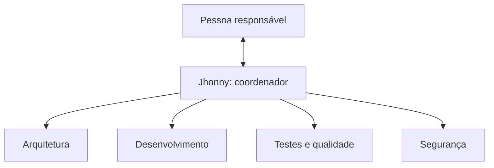
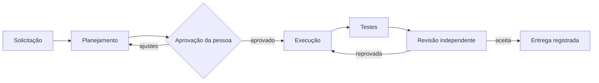

# ORQUESTRA — coordenação de agentes de IA para desenvolvimento

> **Este repositório é uma apresentação pública de um projeto privado.** Ele contém apenas texto e diagramas escritos para este fim. Não há código, prompts, logs, arquivos de governança nem tarefas reais do sistema original.

Autor: [Danilo Vieira da Silva](https://github.com/DaniloVS22) · Outro projeto: [PINEA](https://github.com/DaniloVS22/pinea-case-study)

## O problema

Ao desenvolver software com agentes de IA, quem coordena acaba virando mensageiro: copia respostas de um agente para outro, repete o contexto e não sabe ao certo quem verificou o quê. Isso consome tempo e esconde erros, porque o mesmo agente que escreve também costuma ser o que aprova.

## A ideia

A ORQUESTRA é um projeto experimental que busca reduzir essa carga. Em vez de conversar com vários agentes, a pessoa conversa com **um coordenador**, e ele distribui o trabalho para agentes com papéis distintos. Quem executa não aprova o próprio trabalho.

Não é uma plataforma comercial nem um produto em produção. É um laboratório de método.

## Visão do sistema

## Papéis

| Papel | Responsabilidade |
|---|---|
| **Jhonny (coordenador)** | Único ponto de contato com a pessoa responsável. Investiga, propõe o plano e distribui o trabalho. |
| Arquitetura | Desenha a solução e as decisões técnicas. |
| Desenvolvimento | Implementa o que foi aprovado. |
| Testes e qualidade | Valida o resultado de forma independente de quem o escreveu. |
| Segurança | Revisa riscos e pode bloquear uma entrega. |

## Ciclo ilustrativo

O exemplo abaixo é fictício e serve só para explicar o método.

Exemplo fictício: *"adicionar um filtro por data na lista de pedidos"*.
1. **Solicitação:** a pessoa pede o filtro ao coordenador.
2. **Planejamento:** o coordenador investiga e apresenta um plano curto, com escopo, riscos e critérios de aceite.
3. **Aprovação:** a pessoa lê e aprova. Sem aprovação, nada é executado.
4. **Execução:** o agente de desenvolvimento implementa dentro do escopo.
5. **Testes:** o agente de qualidade valida de forma independente.
6. **Revisão:** segurança e coordenação conferem o resultado e o que foi registrado.

## Governança

- **Aprovação de plano:** para pedidos amplos, o plano é aprovado antes da execução.
- **Fiscalização independente:** ninguém aprova o próprio trabalho.
- **Limites de escopo:** depois da aprovação, os agentes trabalham com autonomia, mas só dentro do que foi combinado.
- **Alto risco e custos:** decisões desse tipo voltam para a pessoa responsável.
- **Rastreabilidade:** cada tarefa deixa registro do plano, das decisões e das verificações. O resumo é o padrão e o detalhe fica sob demanda.

## Aprendizados sobre agentes de IA

- Agentes erram com confiança. Verificação independente é mais barata que corrigir tarde.
- Contexto se perde. Registrar decisões por escrito vale mais que confiar na memória da conversa.
- Papéis claros reduzem confusão. Um agente com função demais tende a fazer tudo de forma rasa.
- Autonomia precisa de limites. Aprovar um plano e delimitar o escopo evita surpresas.
- Governança é custo, mas troca retrabalho por previsibilidade.

## Limites desta apresentação

- Projeto privado e experimental.
- Nenhum resultado medido é divulgado aqui, e a ORQUESTRA não é apresentada como produto comercial.
- Prompts, logs, arquivos de governança e tarefas reais não fazem parte deste material.

## Contato

[LinkedIn](https://www.linkedin.com/in/danilo-silva-3303b912b/) · danilovsilva99@gmail.com
